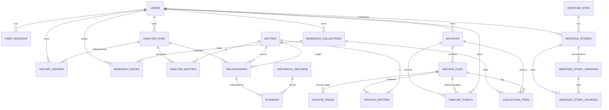

# Database Schema — HeritageGraph AI

**Engine:** SQLAlchemy 2 async over SQLite for local development; PostgreSQL is
supported by the same models/migrations and the `psycopg` driver.  
**Migrations:** Alembic, revisions `0001`–`0008`.  
**Verified head:** `0008_heritage_stories` (SQLite, 31 Oct 2026).  
**Tables:** 21 application tables + `alembic_version`.

The schema is additive: no migration drops a populated table, and every
user-created row carries an ownership foreign key where applicable.

---

## 1. Entity–relationship overview



`heritage_sites` is deliberately independent of user archives: it is curated
demonstration data (`dataset = curated-demo-india`), never mixed with
user-contributed material. `heritage_stories` is the only place community
content is stored; it uses `status` and `provenance` to keep pending/community
records separate from curated records.

---

## 2. Table catalogue

### Accounts and history

| Table | Primary key | Important columns | Purpose |
|---|---|---|---|
| `users` | `id` (string UUID) | `email` (unique), `password_hash`, `display_name`, `created_at` | Accounts. PBKDF2-SHA256 hashes only |
| `user_sessions` | `id` | `user_id` → users, `token_hash`, `expires_at`, `created_at` | Opaque sessions; only a SHA-256 digest is stored |
| `history_entries` | `id` | `user_id` → users, `analysis_id` → analysis_runs (SET NULL), `kind`, `status`, `query`, `summary`, `payload`/`graph` JSON, `created_at` | Owner-scoped search/analysis history; reopening never re-runs AI |
| `analysis_runs` | `id` | `user_id` (SET NULL), `status`, `subject`, `extracted_text`, interpretation JSON, `warnings`, timestamps | One image-analysis run |

Indexes include `ix_users_email` (unique),
`ix_user_sessions_user_id`, `ix_user_sessions_expires_at`,
`ix_history_entries_user_created`, `ix_history_entries_analysis_id`,
`ix_analysis_runs_user_id`, `ix_analysis_runs_status`,
`ix_analysis_runs_created_at`.

### Image analysis and evidence

| Table | Primary key | Important columns | Purpose |
|---|---|---|---|
| `entities` | `id` | `name`, `entity_type`, normalised key | Shared entity vocabulary; unique `(name, entity_type)` |
| `analysis_entities` | `(analysis_id, entity_id)` | both FKs, `role`/`confidence` where available | Join: entities found in an analysis |
| `relationships` | `id` | `analysis_id` → analysis_runs, `source_entity_id`/`target_entity_id` → entities, `relationship_type`, `verification_status` | Candidate relationships proposed by a run |
| `evidence` | `id` | `relationship_id` → relationships, `record_id` → historical_records, verdict/quote | Records evaluated per relationship |
| `historical_records` | `id` | `title`, `source`, `url`, `summary`, `content`, `published` | Retrieved/local historical records; unique `(title, source)` |

Indexes: `ix_entities_name`, `ix_entities_entity_type`,
`ix_relationships_source_entity`, `ix_relationships_target_entity`,
`ix_evidence_relationship_id`, `ix_historical_records_source`.

### Heritage Archive Studio

| Table | Primary key | Important columns | Purpose |
|---|---|---|---|
| `archives` | `id` | `user_id` → users, name, description, region, tags, status, timestamps | Owner-scoped archive |
| `archive_files` | `id` | `archive_id`, `user_id`, `parent_file_id`, `storage_key`, `original_name`, `mime_type`, `size`, `sha256`, `status`, `failure_reason`, extracted text/metadata | One preserved file and its processing state |
| `archive_pages` | `id` | `file_id` → archive_files, `page_number`, `text`, `language` | Page/slide text; unique `(file_id, page_number)` |
| `archive_entities` | `(file_id, entity_id)` | FKs | Entities mentioned in a file |
| `timeline_events` | `id` | `user_id`, `archive_id` (nullable), `file_id` (nullable), `date_text`, `year`, `era`, `precision`, `page` | Dated passages, with BCE/CE and precision |

Indexes: `ix_archives_user_created`, `ix_archive_files_archive`,
`ix_archive_files_user`, `ix_archive_files_sha256`, `ix_archive_files_status`,
`ix_archive_files_parent`, `ix_archive_pages_file`,
`ix_archive_entities_entity`, `ix_timeline_events_user`,
`ix_timeline_events_archive`, `ix_timeline_events_file`.

Uploaded bytes are **not** stored in the database: `archive_files.storage_key`
points at the preserved original under `HG_STORAGE_DIR`.

### Research workspace

| Table | Primary key | Important columns | Purpose |
|---|---|---|---|
| `research_collections` | `id` | `user_id`, name, description, timestamps | A collection of archives/files |
| `collection_items` | `id` | `collection_id`, `archive_id` (nullable), `file_id` (nullable), position | Membership |
| `research_notes` | `id` | `user_id`, `collection_id` (nullable), subject, body, timestamps | Owner-scoped notes |

Indexes: `ix_research_collections_user`, `ix_collection_items_collection`,
`ix_research_notes_user`, `ix_research_notes_collection`.

### India Heritage Explorer and stories

| Table | Primary key | Important columns | Purpose |
|---|---|---|---|
| `heritage_sites` | `id` (slug) | name, alternative names, region, state, UT flag, district/city, category, period group/period, style, UNESCO status/year, lat/lon, coordinate source/accuracy, verification status, description, source refs, image fields, dataset | 67 curated, sourced heritage records |
| `heritage_stories` | `id` | `site_id` → heritage_sites, title, summary, narrative, category, narrative_type, tradition, language, community, period, cultural_background, verification_status, provenance, dataset, `status`, `contributor_id` → users (SET NULL), contributor_display, interview_date, consent, timestamps | One sourced narrative or community submission |
| `heritage_story_versions` | `id` | `story_id` → stories, label, summary, narrative, tradition, language, community, differences, verification_status | One tradition's account; never merged into the main story |
| `heritage_story_sources` | `id` | `story_id` → stories OR `version_id` → versions, title, author, source_type, published, url, excerpt, locator, licence, position | Typed, traceable sources |

Indexes: `ix_heritage_sites_region`, `ix_heritage_sites_category`,
`ix_heritage_sites_state`, `ix_heritage_sites_period_group`,
`ix_heritage_sites_unesco`, `ix_heritage_stories_site`,
`ix_heritage_stories_category`, `ix_heritage_stories_status`,
`ix_heritage_story_versions_story`, `ix_heritage_story_sources_story`,
`ix_heritage_story_sources_version`.

---

## 3. Ownership and deletion rules

| Data | Owner field | Access rule |
|---|---|---|
| Analyses | `analysis_runs.user_id` | Only the session user; another account receives `404` |
| History | `history_entries.user_id` | List/detail/export filter by session user |
| Archives/files | `archives.user_id`, `archive_files.user_id` | Every read/write is scoped; another account gets `404` |
| Collections/notes | `user_id` on both | Owner-scoped |
| Heritage sites/stories | no user owner (curated) | Public read; community stories have `contributor_id` and `status` |
| Uploaded originals | not a DB row | Stored on disk under an opaque key; access only through owner-scoped file routes |

Foreign keys use `CASCADE` for owned child rows (archives → files → pages,
story → sources/versions) and `SET NULL` for references that must survive the
deletion (user → analysis/history, contributor → story).

---

## 4. Migrations

| Revision | Contents |
|---|---|
| `0001_initial_schema` | Core analysis tables: runs, entities, historical records, relationships, evidence, analysis_entities |
| `0002_historical_record_url` | Canonical source URL on records |
| `0003_analysis_interpretation` | Vision interpretation payload |
| `0004_analysis_briefing` | Briefing payload on runs |
| `0005_users_sessions_history` | Users, sessions, ownership columns, history entries |
| `0006_archive_studio` | Archives, files, pages, archive entities, timeline, curated heritage sites, research collections/items/notes |
| `0007_india_heritage` | National metadata: region, period bucket, alternative names, district/city, style, UNESCO, coordinate provenance, multiple sources |
| `0008_heritage_stories` | Stories, sources, alternative versions, contributor/consent/moderation fields |

Run them with:

```bash
cd backend
python -m scripts.run_server --migrate          # schema only
python -m scripts.run_server --migrate --seed   # + curated records (idempotent)
```

The `--seed` path upserts the historical seed, 67 heritage sites and 18 stories;
it does not overwrite community rows.

---

## 5. Local data and retention

- `backend/heritage.db` is the local SQLite file (git-ignored). At audit time it
  contained 8 users, 21 sessions, 114 analyses, 4 archives, 5 files, 67 sites and
  18 stories. **Do not publish it.**
- Uploaded originals are in `backend/var/archive` (git-ignored) and are separate
  from database rows.
- There is no automatic retention job, account-wide deletion or backup schedule.
  Production requires a managed database with backups and a policy for uploaded
  objects.
- Curated seeds are part of the repository; local user data is not.

---

## 6. Query and scaling notes

- Async SQLAlchemy sessions are created through `session_scope()`; every
  repository query is parameterised (no string-built SQL).
- SQLite is single-writer. The current workload is demo-sized; production
  should use PostgreSQL.
- Hot-path indexes are listed above (owner+created, archive+created, file,
  sha256, status, heritage filters, story site/category/status).
- Archive ingestion and PDF generation run per request/background task, not via
  a queue; see `docs/known-limitations.md` §7–§8.
