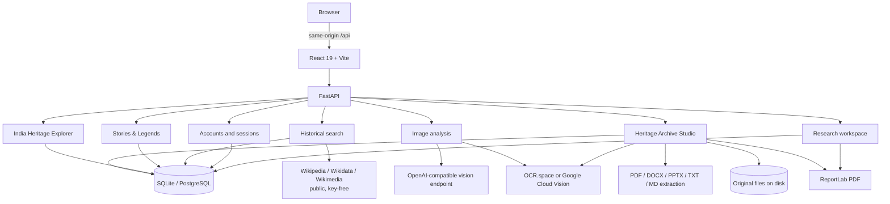

# Technical Approach — HeritageGraph AI

**Project:** HeritageGraph AI  
**Tagline:** From Forgotten Archives to Living Cultural Knowledge  
**Problem statement:** HC26-CULT01 — Digital Revitalisation of Unstructured
Cultural & Architectural Heritage Archives  
**Document status:** describes the implementation present in this repository, not
a proposed design. Unimplemented ideas are labelled as future work.

---

## 1. Problem understanding

Cultural and architectural heritage documentation is produced continuously —
site photographs, scanned reports, conservation PDFs, presentation decks, travel
journals, regional-language notes — and then lands in disconnected folders. The
information is real but not usable as knowledge:

- a photograph cannot be searched by the text it contains;
- a scanned report cannot be queried by page;
- its people, monuments and events are not linked to one another;
- its dates are not on a timeline;
- its claims have no visible provenance;
- every new researcher starts from zero.

The problem is therefore not scanning alone. It is the conversion of
**unstructured material into structured, connected, evidence-backed knowledge**
without inventing the missing parts.

## 2. Solution approach

HeritageGraph AI combines six connected systems over one database and one
same-origin API:

```text
Upload / search
      |
      v
Digitise (OCR, PDF text layer, DOCX/PPTX extraction)
      |
      v
Extract (text, language, entities, dated passages)
      |
      v
Understand (vision reading, grounded retrieval, candidate identification)
      |
      v
Connect (relationships, evidence, knowledge graph, heritage map, stories)
      |
      v
Explore (subject pages, related topics, timeline, map, story library)
      |
      v
Preserve / export (owner-scoped archives, history, PDF reports)
```

The design principle is that **every displayed claim has a visible basis**:
retrieved records, OCR text, a source citation, or an explicit statement that
the evidence is missing. A provider failure produces an error or a partial
result, never demo text.

## 3. Architecture



One origin is deliberate: the Vite dev server (and any reverse proxy) forwards
`/api`, so the browser makes no cross-origin request and there is no CORS step
that can fail per browser. Provider credentials never reach the browser.

## 4. Archive processing

`POST /api/archives/{id}/files` accepts up to 20 files per request (25 MB each,
100 MB per ZIP, 150 MB per multipart request). Each file is processed
independently in a background task so that one failure does not stop the rest.

```text
Validate (content sniffing, size, allowed type)
      |
      v
Store original under an opaque key (never in a DB column)
      |
      v
Classify: image | PDF | DOCX | PPTX | TXT | Markdown
      |
      v
Extract:
  image          -> OCR provider
  PDF            -> text layer, page by page; scanned pages rasterised for OCR
  DOCX           -> package XML: paragraphs, headings, tables
  PPTX           -> package XML: slides and speaker notes
  TXT / MD       -> decoded text
      |
      v
Normalise text; detect language
      |
      v
Extract entities and dated passages (page/slide reference retained)
      |
      v
Detect duplicates: SHA-256, dHash, normalised-text fingerprint
      |
      v
Persist pages, entities, timeline events, status
```

Status is `completed`, `partial` or `failed` with a stored reason. A scanned
document with no configured OCR provider is `partial`, with an explicit reason;
it is never filled with sample text. The original ZIP is retained for provenance
while unsafe members (traversal, absolute paths, executables, nested archives,
over-limit entries) are skipped with warnings.

Search over archives is **keyword search**, labelled `mode: keyword` in the API
and UI. No embedding provider is configured; the product does not call it
semantic search.

## 5. Image intelligence

`POST /api/analysis` (authenticated) accepts one image up to 10 MiB. Validation
uses magic-byte sniffing for JPEG, PNG, WebP, GIF, TIFF and AVIF — not the
filename or the client-supplied MIME type.

The vision provider receives the **actual uploaded bytes** and returns
structured observations: description, candidate identification, alternatives,
uncertainty and any text it can read. OCR is a separate capability:

- when an OCR provider is configured, its text is used for extraction and the
  vision model's reading remains a separate, labelled observation;
- when none is configured, the run carries an explicit warning rather than
  presenting the vision reading as a verified inscription;
- an empty OCR result stays empty.

Extracted entities drive historical retrieval, briefing construction, candidate
relationships and the graph. Each relationship is evaluated against retrieved
records to assign `verified`, `disputed`, `unsupported` or `unverified`. A model
opinion never produces `verified`.

If a required stage fails, the analysis fails with a sanitised message. If
optional text extraction returns nothing but the required stages succeeded, the
run is `partial`, not `completed`.

## 6. Document intelligence

- **PDF:** `pypdf` reads the text layer page by page; `pypdfium2` rasterises
  scanned pages for OCR when installed.
- **DOCX:** paragraphs, headings, tables and text boxes are read from the
  package XML.
- **PPTX:** slide text and speaker notes are read from the package XML.
- **TXT / Markdown:** decoded directly.

Page and slide numbers are preserved with each passage, so archive search
results point at the exact page an excerpt came from. Complex layout, charts and
embedded images inside DOCX/PPTX are not reconstructed or re-analysed.

## 7. OCR

One adapter normalises three providers:

1. **OCR.space** — `POST https://api.ocr.space/parse/image`, API key in the
   server-side header/field. This is the live-verified provider in this
   workspace.
2. **Google Cloud Vision** — `files:annotate` with
   `DOCUMENT_TEXT_DETECTION`, suitable for photographs, printed documents,
   plaques and multiple text regions. Authentication uses Application Default
   Credentials (`GOOGLE_APPLICATION_CREDENTIALS`) or the configured API-key
   path; no credential is exposed to the browser.
3. **Generic HTTP OCR** — a configured endpoint/key pair for local experiments.

The adapter normalises text and page/region information into one result shape.
Provider errors (missing credentials, permission failure, disabled API, quota,
timeout, network error, malformed response) are surfaced as safe provider
errors. Handwriting and historical scripts remain a known limitation; the
system reports what was read rather than guessing.

The Google Cloud Vision path is covered by mocked annotate-response tests. It
has **not** been called live in this workspace because no GCP project
credentials are present.

## 8. Entity extraction

Entities are normalised to a small type vocabulary and de-duplicated. Dates are
extracted as written (exact, approximate, century, range, BCE/CE), preserving
precision. Page/slide references are retained for archive entities. Entity
extraction is rule/pattern based over the extracted text; it is not a trained
named-entity-recognition model, which is why confidence is not fabricated.

## 9. Knowledge graph

Nodes are extracted entities (image analysis) or the searched subject and
retrieved records (text search). Edges are persisted relationships with a
verification status and the evidence records evaluated for them.

The graph is rendered with Cytoscape.js. Selecting an edge opens the evidence
panel: which records were evaluated, how many support/dispute it, and the
resulting status. Text-search graph edges are limited to:

- `retrieved for` — a record retrieved for the query, with that record as
  evidence;
- `mentions` — one retrieved record's title appears verbatim in another's text,
  with the containing sentence as evidence.

No edge is inferred from co-occurrence alone. A search with no records returns
an empty graph and says so.

Stories use their own provenance chain (site → story → source/version), not the
image-analysis graph. Entity-level story graph nodes (person/deity/community)
are **not implemented**; this is stated in `docs/known-limitations.md`.

## 10. Search

`GET /api/search?query=…`:

1. validates and normalises the query;
2. classifies it as year / named entity / general;
3. retrieves candidates from the local record store and, when enabled, live
   Wikipedia/MediaWiki APIs;
4. ranks by exact/normalised title match, phrase match, full-text and source
   quality;
5. builds an **extractive** briefing: summary and explanation sentences are
   selected from the retrieved records, each with the citation index of its
   record;
6. returns the subject's photograph, description, type and related topics from
   the same public sources.

It is keyword/lexical retrieval with source ranking. There is no vector index,
embedding model or semantic re-ranker in this build. Live-source failures
produce a degraded-source notice rather than a false “no results”.

## 11. Historical stories

The Stories & Legends layer keeps different kinds of knowledge apart:

- **Category** — what the story is about (history, mythology, religious
  tradition, local legend, architecture, culture, lesser-known, oral history).
- **Narrative type** — the epistemic basis (historically documented,
  archaeological support, religious text/tradition, mythological narrative,
  local folklore, oral history, scholarly interpretation, unverified account,
  conflicting accounts, community account).
- **Verification status** — the record's own review state (`source-checked`,
  `unverified`, `pending-review`, `community-approved`). It is not a truth score.
- **Sources** — typed, with author, date, URL, locator, excerpt and licence
  where available.
- **Versions** — separate accounts of the same story, each with its own
  tradition, community, differences and sources. They are never merged.

The curated seed contains 75 stories for 67 sites, 86 story-level sources plus
4 attached to alternative versions, and 2 versions of the Konark origin story.
The corpus is hand-compiled and source-checked; there is no automated crawler
and no generative storyteller. `POST /api/heritage/stories/ask` performs
retrieval over stored stories, requires at least two shared terms, joins the
matching summaries and citations, and states when the library cannot answer.

Community submissions require sign-in, consent and same-origin; they are stored
`pending`. Only an account listed in `STORY_MODERATOR_EMAILS` can approve or
reject. Approval labels the record a community account, not verified history.

## 12. India Heritage Explorer

The curated dataset lives in `heritage_sites` (migration `0007`), not in a
frontend constant. `GET /api/heritage/sites` supports `q`, `state`, `region`,
`category`, `periodGroup`, `unesco`, `story`, `sort`, `limit` and `offset`, and
returns the filtered total, national summary, per-site story counts and complete
state/UT facets. The map page requests the curated set once (capped at 500) and
applies the same filters in the browser.

Coordinates are published figures rounded to four decimals and marked
`approximate`; records without a coordinate are listed but not plotted. The
route builder computes great-circle distances and labels the result
“Approximate heritage route”; no road routing, travel time, opening hours or
ticket prices are claimed.

## 13. Data storage

- **Relational data:** SQLAlchemy 2 async over SQLite (development) or
  PostgreSQL (supported by configuration; not exercised here).
- **Migrations:** Alembic, additive `0001`–`0008`, run at startup with
  `python -m scripts.run_server --migrate`; curated data is loaded with
  `--seed` (idempotent upserts).
- **Uploaded originals:** preserved under `HG_STORAGE_DIR` (default
  `backend/var/archive`), outside the database, with opaque keys. Extracted text
  is stored page by page in the database.
- **Ownership:** every user-created row carries `user_id`; reads filter on the
  session user in SQL, never on a client-supplied id.
- **Local state:** `backend/heritage.db`, uploads, logs and dependency folders
  are git-ignored.

## 14. Security

- **Passwords:** PBKDF2-HMAC-SHA256 with per-password salt; no plaintext.
- **Sessions:** opaque 256-bit random tokens; only a SHA-256 digest is stored
  server-side; HttpOnly, SameSite=Lax cookie, Secure when the request is HTTPS
  (behind a trusted proxy).
- **CSRF:** state-changing routes verify same-origin `Origin`/`Referer`
  against the declared application origin; tests cover the proxied case.
- **Rate limits:** credential endpoints are rate-limited. Other endpoints rely
  on upload limits and deployment-level controls; no global limiter is built in.
- **Authorization:** owner-scoped SQL for analyses, archives, files, history,
  collections, notes and exports. Cross-account access returns `404`.
- **Uploads:** content sniffing, size limits, safe filenames/opaque storage,
  ZIP traversal/executable/nesting/ratio protections.
- **Media proxy:** only allowlisted Wikimedia image hosts, with size limits.
- **Secrets:** server-side only; local files are ignored; examples contain
  placeholders. No credential appears in frontend code or tracked files.

These are the verified controls, not a claim of complete security. See
`SECURITY.md` and `docs/known-limitations.md`.

## 15. Scalability and current limits

- Archive processing runs inside the API process's background tasks, not a
  durable job queue. It is reliable for demo-sized batches (20 files × 25 MB per
  request) but not for hundreds of concurrent documents.
- SQLite serialises writes; PostgreSQL is the intended production database.
- Search and retrieval are synchronous per request; live source latency is the
  main variable (measured 0.02–6 s locally).
- The map returns at most 500 curated records per request; the current dataset is
  67. Marker clustering is client-side grid grouping, not a tile server.
- PDF reports are generated on demand with ReportLab; no background export
  queue.
- No shared cache layer; provider responses are not cached across users.
- Suggested next steps: PostgreSQL + a worker queue, a global rate limiter,
  response caching for public sources, and object storage for uploads.

## 16. Design decisions

| Decision | Why it suits this project |
|---|---|
| One same-origin deployment | Removes CORS/credential complexity and matches how a hackathon demo is run: `npm run dev`, one URL |
| SQLite locally, PostgreSQL supported | Zero-setup local evaluation without pretending production constraints away |
| Extract-then-cite briefings | Avoids unsourced generation and makes every sentence inspectable |
| Separate OCR and vision | Text extraction and visual interpretation are different claims; the UI can label each honestly |
| Curated heritage/story data with explicit provenance | A cultural-heritage demo must not invent monuments, coordinates or legends |
| Keyword search, labelled as keyword | No embedding provider is configured; claiming semantic search would be false |
| Owner-scoped rows in one schema | Simpler than multi-tenant infrastructure while still enforcing isolation in SQL |
| Alembic migrations from the start | The schema grew across eight features without destructive resets |
| No Docker in this pass | The verified workflow is `npm run setup` / `npm run dev`; adding an untested container would create a second, unverified deployment path. A Docker option is left as future work |

## 17. What is deliberately not built

Semantic/vector search, automatic story discovery, translated story texts,
entity-level story graphs, a generative storyteller, road routing, 3D/GLB
viewer, historical image comparison, email verification/password reset, a
public discovery portal and a durable job queue. These are listed with impact
and possible approaches in `docs/known-limitations.md`; none is described as
working in the README.
